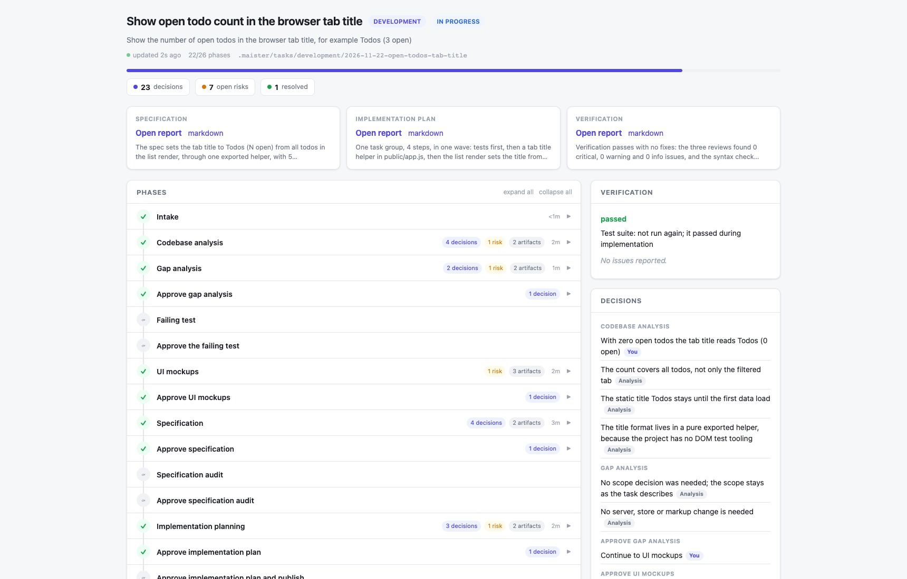

<div align="center">

# Maister

**Structured, standards-aware development workflows for Claude Code and GitHub Copilot CLI**

[](https://github.com/SkillPanel/maister/releases)
[](https://github.com/SkillPanel/maister/actions/workflows/test.yml)
[](LICENSE)

</div>

Maister gives a coding agent a working method. You describe a task. A workflow reads your codebase, writes a specification and a plan, builds the change test-first, and checks the result with your test suite and three independent reviews. It stops at checkpoints for your decision, and it follows the coding standards it found in your own project.

<p align="center">
  
</p>

## Quick start

You need [Claude Code](https://claude.ai/code) 2.1.233 or newer and Node.js 20 or newer.

```bash
/plugin marketplace add SkillPanel/maister
/plugin install maister@maister-plugins
```

Restart Claude Code. Then set your project up once, and give it a task:

```bash
/maister:init
/maister:development Add CSV export to the orders page
```

`/maister:init` reads your configuration, code and documentation. It writes the standards and project facts it finds to `.maister/docs/`, and its settings to `.maister/config.yml`. Every workflow reads them from then on.

<details>
<summary><b>On GitHub Copilot CLI</b></summary>

You need Copilot CLI 1.0.100 or newer and Node.js 20 or newer.

```bash
copilot plugin marketplace add SkillPanel/maister
copilot plugin install maister@maister-plugins
```

Commands are typed the same way as on Claude Code: `/maister:init`, `/maister:development`. [Maister on GitHub Copilot CLI](docs/copilot.md) covers the rest, including the one-time reinstall if you used the earlier `maister-copilot` plugin.

</details>

## What a run looks like

A development run has six stages, and it stops after each of the first five:

```text
analysis → ◆ → specification → ◆ → plan → ◆ → implementation → ◆ → verification → ◆ → summary

◆  a checkpoint: you decide whether the run goes on
```

The task shapes the run. A bug gets a failing test before the fix. A change to the user interface gets mockups before the specification. A specification audit, browser checks and a user guide with screenshots are offered along the way.

At a checkpoint, the question arrives with what you need to answer it:

```text
Approve specification? Type "details" for the full brief.

❯ Continue to the specification audit (Recommended)
  Continue to planning, skip the audit
  Revise the specification
  Stop here

  Done: Specified a CSV export of the filtered orders list: 9 requirements and
        2 user stories, reusing the existing report streamer.
  Next: Specification audit
  Review: implementation/spec.md (HTML beside it)
  Open risks:
  - Excel misreads UTF-8 CSV without a byte-order mark; the spec adds one

  Decided by the run:
  - Stream the file instead of building it in memory — specification
  - The export respects the active filters — specification
```

**Revise** sends the run back to the step that wrote the document, with a note you pick from suggestions or type yourself. That step and everything after it run again, and the checkpoint asks once more.

Everything a run produces is a file in your repository:

```text
.maister/tasks/development/2026-03-24-orders-csv-export/
├── orchestrator-state.yml     where the run is; what a resume reads
├── dashboard.html             the run in a browser: phases, decisions, risks
├── analysis/                  codebase analysis, gap analysis
├── implementation/            spec.md, implementation-plan.md, work-log.md
└── verification/              test results, the three reviews, the report
```

Close the session whenever you like. Give the same command the task directory, and the run carries on from where it stopped:

```bash
/maister:development .maister/tasks/development/2026-03-24-orders-csv-export
```

A run changes your working tree and commits nothing. It ends with a summary, a commit message in a file and the next steps. Start it with `--publish`, and approving the plan also approves publishing: the run commits on a branch of its own, pushes it and opens a pull request. It never merges.

[Getting started](docs/getting-started.md) walks through a first run, checkpoint by checkpoint.

## Why use it

| What goes wrong with a coding agent | What Maister does about it |
|---|---|
| It starts coding before it understands the codebase | Analysis and a gap analysis come first, and you approve them before anything is specified |
| It builds something other than what you meant | You approve a specification, and can have an independent agent audit it, before a plan exists |
| It ignores how your team writes code | Standards are discovered from your repository and read while specifying, planning and coding |
| It reports success too early | The full test suite, your lint, type and build checks and three reviews run first. Clear fixes are made and re-checked |
| A long session loses the thread | Work is done by subagents, state lives in files, and a run resumes from its task directory |
| The process is someone else's | Workflows are definitions. Add a step to a built-in, or write your own |

## Pick your command

| When you have | Run | You get |
|---|---|---|
| A feature, an enhancement or a bug | `/maister:development` | A specified, planned, tested and reviewed change |
| A question to answer before building | `/maister:research` | A report with its evidence, then optionally compared solutions and a high-level design |
| An idea that is not a specification yet | `/maister:product-design` | A brief with the final screens, ready to build from |
| Screens to draw or redraw | `/maister:mockup-studio` | One new version of a set of mockups |
| Slow code | `/maister:performance` | Bottlenecks found by reading the code, then fixed |
| A technology, platform or architecture to move | `/maister:migration` | A staged migration with a rollback plan |
| A task or an issue, and no idea which fits | `/maister:work` | The right workflow, chosen for you |

`/maister:work` takes a description, or an issue from GitHub, Jira or Azure DevOps.

Workflows hand over to each other. Pass a finished research or product-design task to development, and its report, brief and screens become the starting point:

```bash
/maister:development "Build the usage page" --design=.maister/tasks/product-design/2026-03-10-usage-page
```

For smaller jobs, without a full run:

| Run | To |
|---|---|
| `/maister:quick-plan` | Plan a change with your standards in view, before you code |
| `/maister:quick-dev` | Implement a change you already understand, with standards applied |
| `/maister:quick-bugfix` | Fix a bug test-first: a fix plan, a failing test, the fix |
| `/maister:quick-design` | Settle one small design question and keep a decision record |
| `/maister:update-branch` | Bring your branch up to date with its default branch, and keep an unfinished run's review to its own work |

[Workflows](docs/workflows.md) describes each workflow's steps and checkpoints, and the [command reference](docs/commands.md) lists every command and flag.

## Standards that come from your code

`/maister:init` looks at your configuration files, your source and your documentation, and writes down the conventions it finds, with a tech stack, an architecture document and an index. They live in `.maister/docs/` as Markdown you can read and edit.

- Workflows read them while specifying, planning and coding, and the code-risk review reports each rule a change breaks.
- A finished run lists the conventions it met that no standard covers yet. `/maister:standards-update` offers them, and you choose which to keep.
- `/maister:standards-discover` looks again as the codebase changes.
- Any Markdown file your team adds under `.maister/docs/` gets an entry in the index, so workflows find it too.

More in [Standards](docs/standards.md).

## Verification sized to your project

Every change gets the same three reviews, each by its own agent:

| Review | Asks |
|---|---|
| Spec conformance | Does the code do what the specification and your decisions say? |
| Code risk | What can break, leak or fall over where this project runs? |
| Simplicity | Is there complexity this project does not need? |

They judge against a profile of your project. A command-line tool is not asked for rate limiting, and a project with no data store is not asked for down-migrations.

Findings with a clear, safe fix are fixed and re-checked without a question. What is left reaches you one finding at a time, each with the proposed change, the alternatives and a recommendation.

Each review also runs on its own: `/maister:reviews-spec`, `/maister:reviews-code-risk`, `/maister:reviews-simplicity`, and `/maister:reviews-spec-audit` for a specification before anything is built from it.

The project profile and the reviewers' models are set in [Configuration](docs/configuration.md); [Workflows](docs/workflows.md) describes the verification step.

## Design before you build

- **`/maister:product-design`** turns a rough idea into a brief. It explores the project, proposes the scope, asks each design decision with sketches of its options, and ends with the final screens.
- **`/maister:mockup-studio`** draws one new version of a set of mockups each time you call it, and keeps every earlier version. Screens are drawn in your product's own colours, fonts, layout and copy, harvested from the codebase. They come as HTML pages with a gallery, or as ASCII in the terminal; for one turn it can also write a scope as text, a list of what is in and out, with each change marked.
- **`/maister:quick-design`** settles one small question: the options, a recommendation, your decision, a one-page record.

Product design and quick design feed development. Pass the task with `--design`, and the chosen screens become binding references for the plan, the implementation and the browser checks.

More in [Mockups](docs/mockups.md).

## Workflows of your own

The built-in workflows are definitions, and yours run on the same engine. This overlay adds your own security reviewer to every development run, after verification and before its checkpoint:

```yaml
# .maister/workflows/development.overlay.yml
extends: builtin:development

add:
  security-review:
    uses: agent:security-reviewer     # an agent in your project's .claude/agents/
    needs: [verification]
    before: [verification-approval]
```

<details>
<summary><b>A whole workflow of your own, in one file</b></summary>

```yaml
# .maister/workflows/release-notes.yml
name: release-notes
version: 1
description: "Drafts release notes from the changes since the last tag, for review before they are published."
inputs:
  version: {type: string, required: true}

nodes:
  draft:
    uses: direct:draft
    needs: []
    with: {version: "${inputs.version}"}
    outputs:
      artifacts: {notes: outputs/release-notes.md}

  approve:
    type: gate
    needs: [draft]
    ask: "Release notes drafted. Publish them?"
    options:
      publish: continue
      revise: {effect: revise, reruns: draft}
      stop: stop

  publish:
    uses: direct:publish
    needs: [approve]
```

What `draft` and `publish` do is written in plain language in `release-notes.md` beside it. Then:

```bash
/maister:run release-notes version=3.1.0
```

</details>

A workflow of your own gets the same checkpoints, dashboard and resume as a built-in. A step can be prose you write, one of your skills, one of your agents, or another workflow. `/maister:workflow-author` interviews you and writes the files, and `/maister:run <name> --check` validates a workflow without starting it.

More in [Extending Maister](docs/extending.md), with every built-in's steps and checkpoints by id in the [workflow reference](docs/workflow-reference.md).

## How it works

A workflow is a graph of steps and checkpoints in a YAML file. When a run starts, the workflow engine copies that graph into the run's state and works through it, so a plugin upgrade or an edited definition does not change the steps and checkpoints of a run already in flight.

Every change to a run's state goes through the engine, and the engine refuses what the graph does not allow: a step recorded as done before the checkpoint in front of it has an answer, an answer the checkpoint does not offer, a run closed while steps it can still reach have not run.

The work is done by subagents: analysts, a specification writer, implementers that run side by side, reviewers. Each has its own context, which keeps your session free for the decisions. `.maister/config.yml` sets the model each kind of agent runs on. By default the reviewers get a stronger model than the clerical agents.

What Maister does not do:

- **Commit, push or open a pull request**, unless you start the run with `--publish`. It never merges.
- **Roll back on its own.** When a step fails, the run stops and asks you.
- **Let a subagent destroy work.** A hook blocks `git reset --hard`, `git checkout .`, `git clean`, `git stash`, force pushes and `rm -rf` from subagents.
- **Phone home.** Maister is prompts, a Node.js engine and files under `.maister/` in your repository. It has no account, no service and no telemetry, and its hooks send nothing anywhere.

Every setting in `.maister/config.yml`, the task directory layout and the subagent models are described in [Configuration](docs/configuration.md).

## Claude Code and GitHub Copilot CLI

| | Claude Code | GitHub Copilot CLI |
|---|---|---|
| Plugin | `maister` | `maister` |
| Commands | `/maister:<name>` | `/maister:<name>` |
| Checkpoints | Options, with the detail beside the one you are on | The same detail, in the question |
| Run status in the terminal | A band above the prompt and a panel at each checkpoint | Not drawn |
| Implementation and verification | Each loop runs in a subagent of its own | The loops run in your session |
| Browser steps | `playwright-cli`, a Playwright MCP server, Claude in Chrome or the desktop app's browser | `playwright-cli` |

Browser checks, user guides with screenshots and the mockup gallery use the browser tool your session already has. Maister ships none, and without one those steps are offered without the browser.

More in [Maister on GitHub Copilot CLI](docs/copilot.md).

## Documentation

The [documentation index](docs/README.md) routes you by what you want to do. The pages:

- [Getting started](docs/getting-started.md): a first project and a first run, checkpoint by checkpoint
- [Workflows](docs/workflows.md): the steps and checkpoints of each built-in workflow
- [Command reference](docs/commands.md): every command and flag
- [Standards](docs/standards.md): how standards are found, kept and applied
- [Mockups](docs/mockups.md): mockup versions, the grounding pack, HTML or ASCII
- [Configuration](docs/configuration.md): `.maister/config.yml`, task directories, subagent models, the project profile, browser tools
- [Extending Maister](docs/extending.md): overlays, your own workflows, your skills and agents as steps
- [Workflow reference](docs/workflow-reference.md): each built-in's steps and checkpoints by id, for overlay authors
- [Maister on GitHub Copilot CLI](docs/copilot.md): installing, running and the differences
- [Upgrading from 2.x](docs/upgrading-from-2x.md): what changes and what to do first
- [Troubleshooting](docs/troubleshooting.md): symptoms and fixes
- [Changelog](CHANGELOG.md): what changed in each release

## Upgrading

```bash
claude plugin marketplace update maister-plugins
claude plugin update maister@maister-plugins
```

Then run `/reload-plugins`, or start a new session. On GitHub Copilot CLI, `copilot plugin update maister@maister-plugins` does the same.

> [!IMPORTANT]
> Coming from 2.x? Version 3 needs Node.js 20 and does not resume tasks started on 2.x. Read [Upgrading from 2.x](docs/upgrading-from-2x.md) before you update.

<details>
<summary><b>The beta channel</b></summary>

Pre-release versions install from the `beta` branch. Only one Maister channel can be enabled at a time, so uninstall the stable one first:

```bash
/plugin uninstall maister@maister-plugins
/plugin marketplace add SkillPanel/maister#beta
/plugin install maister@maister-plugins-beta
```

On Claude Code, if two channels are enabled together, a warning at session start names both and the command that disables each, and workflows do not start or resume until only one is enabled and the session restarted. [Troubleshooting](docs/troubleshooting.md) has the fix.

</details>

## Contributing

Issues and pull requests are welcome. [CONTRIBUTING.md](CONTRIBUTING.md) has the build and test loop.

## License

[MIT](LICENSE)
